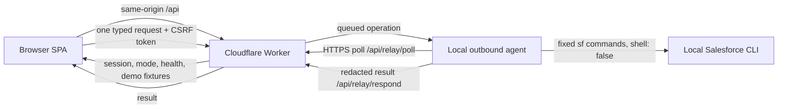

# Data Cloud Architect Toolkit (DCAT)

A local-first, read-only workbench for discovering Salesforce Data Cloud / Data 360 metadata through Salesforce CLI. Run it locally, or use the public hosted site with a small outbound bridge agent on your own machine. Salesforce authentication always happens in Salesforce CLI on that machine — DCAT never hosts OAuth and never collects credentials.

> **Foundation and live discovery are complete.** Org connection, demo mode, and read-only live Data 360 discovery all work. Live inventory is discovered through the Salesforce CLI; unsupported, forbidden, or malformed responses are reported honestly instead of being shown as empty results.

## Product principles

- Read-only by default: no create, update, delete, deploy, activate, ingest, or refresh actions.
- Local-first authentication: reuse Salesforce CLI sessions; never ask for passwords, tokens, or auth URLs.
- Metadata before data: no customer or transaction records are queried.
- Show provenance and relationship confidence; never fabricate counts or relationships.
- Graceful partial support: unsupported or forbidden endpoints produce explicit statuses.

## Prerequisites

- **Node.js** 22.12+ (24 LTS recommended).
- **npm** 10+.
- **Salesforce CLI (`sf`)** installed separately and available on PATH. Install it from the [Salesforce CLI setup guide](https://developer.salesforce.com/docs/platform/salesforce-cli/guide/setup.html). It is *not* an npm dependency of this project.
- An existing CLI-authenticated org for live mode:

  ```bash
  sf org login web --alias my-data360-org --set-default

  # Sandbox example
  sf org login web --alias dcat-uat --set-default \
    --instance-url https://mydomain--uat.sandbox.my.salesforce.com
  ```

Demo mode requires none of the Salesforce prerequisites.

## Run locally

```bash
npm install
npm run dev
```

Open **http://127.0.0.1:5173**. Vite serves the UI and proxies `/api` to the local connector, so the browser uses one local origin.

The UI opens in **demo mode** on first use so the inventory is visible immediately. The preference is stored as `dcat.mode` in local storage; the connector itself still starts in live mode unless `DCAT_DEMO=true` or you switch modes. Use the header mode control, labelled **Use live** or **Use demo**, to switch modes. The header shows the active context explicitly — `DEMO DATA`, `LIVE · SANDBOX`, `LIVE · PRODUCTION`, or `LIVE · NOT CONNECTED` — and a short toast plus a persistent screen-reader announcement confirm each switch. Demo mode is clearly labelled and works even when the Salesforce CLI is not installed.

### Production-style local run

```bash
npm run build
npm start
```

Open **http://127.0.0.1:3847**. The connector serves the built UI and API from the same loopback origin.

## Hosted bridge edition

The public site is a static React SPA (Cloudflare Pages or another static host). A Cloudflare Worker at the same origin provides the browser session, mode, health, demo fixtures, and the relay. **There is no hosted OAuth**: Salesforce remains authenticated by the CLI on the user's machine, `/api/auth/*` paths are removed and return 404, and no OAuth client id, client secret, callback URL, token encryption key, or Salesforce login URL is configured anywhere.

> The local edition above remains the default. `npm run dev`, `npm run build`, and `npm start` are unchanged and still use the loopback Fastify connector.

### Architecture



- The agent connects **outbound** by polling the Worker relay; it needs no inbound port, tunnel, or listening socket.
- The browser never runs `sf`. Only the local agent executes commands, and only six typed operations are accepted: `cli.status`, `org.list`, `org.connect`, `inventory.get`, `transform.get`, and `mode.set`. There is no arbitrary URL/command proxy, shell, SOQL, or record query.
- Results are redacted before they are posted back through `/api/relay/respond`.
- Bridge storage contains only the relay URL, agent token, and version, written with mode `600`. It stores no Salesforce credentials and never reads the CLI credential store.

### Deploy to Cloudflare Pages

`npm run build:pages` builds the hosted SPA **and** emits `apps/web/dist/_worker.js`. Cloudflare Pages advanced mode serves that Worker automatically. Workers Builds uses the root `wrangler.jsonc` to bundle `apps/hosted-worker/src/pages.ts` with `npx wrangler deploy`; the same Worker code serves the SPA and same-origin `/api/*` routes.

1. Create a KV namespace with the exact binding name `DCAT_SESSIONS`. For Pages, bind it in the dashboard; for Workers Builds, put its id in the root `wrangler.jsonc`.
2. Connect the GitHub repo with:
   - Build command: `npm install && npm run build:pages`
   - Build output: `apps/web/dist`
   - Worker deploy command: `npx wrangler deploy` (Workers Builds only)
   - Node version: `22.12.0` or newer
3. Verify `/api/health` returns JSON and `/api/auth/*` returns `404`.

See [docs/CLOUDFLARE_PAGES_SETUP.md](docs/CLOUDFLARE_PAGES_SETUP.md) for the full dashboard walkthrough and [docs/HOSTED_ONBOARDING.md](docs/HOSTED_ONBOARDING.md) for the short user guide. For a local Pages runtime rehearsal, run `npm run pages:dev` and open `http://127.0.0.1:8788`.

The root `wrangler.jsonc` is the Workers Builds deploy config. The separate standalone Worker path is still available with `npm run worker:dry-run`, `npm run worker:dev`, and `npm run worker:deploy`; it requires a real namespace `id` in `apps/hosted-worker/wrangler.jsonc`. There are **no Worker secrets to set**; `apps/hosted-worker/.dev.vars.example` only documents optional `SESSION_TTL_SECONDS`. Never commit a local `.dev.vars`.

> Demo mode works immediately after the Cloudflare deploy. Hosted live-org connection uses the published `@dcat-toolkit/bridge@0.1.1` npm package, so no npm publish step is needed during deployment. See the Cloudflare setup guide.

Worker KV writes are throttled because free-tier Workers KV has write limits; session, pairing, and relay state are kept small and expire. Pairing codes are one-time and short-lived; unpairing invalidates the agent token.

### Connect an org from the hosted site

The **Connect an org** wizard has three steps:

1. **Set up SF CLI.** Create a one-time pairing code, then run the command shown on that screen on the computer that will talk to Salesforce:

   ```bash
   npx -y @dcat-toolkit/bridge@latest setup --relay <site-url> --code <code>
   ```

   The installer installs Salesforce CLI if needed, pairs with this browser session, and starts the bridge immediately. After a restart, `npx -y @dcat-toolkit/bridge@latest start` resumes from saved config. The code only links that browser session.
2. **Connect org.** Choose a local alias and, optionally, an HTTPS sandbox instance URL. The bridge runs the fixed command `sf org login web --alias <alias> --set-default [--instance-url <https Salesforce URL>]` locally; Salesforce CLI opens the browser for login. The user never supplies a username, password, token, or SFDX auth URL to DCAT.
3. **View inventory.** Select the authenticated org in the site and read its Data 360 metadata through the relay.

Demo mode remains available on the hosted site. It bypasses the relay and uses labelled Worker fixtures: all six capabilities available, warnings `[]`, and complete transform detail/lineage/run/schedule bundles. It never shows fixture data under a Live label.

A plain Developer Edition org may not include Data Cloud / Data 360 metadata. The UI reports unsupported or forbidden families explicitly; live transform subresources still need validation against a permitted Data Cloud-enabled org.

### Configuration

Copy `.env.example` to `.env` if you want to change local settings. Only non-secret configuration belongs here:

| Variable | Default | Purpose |
| --- | --- | --- |
| `DCAT_PORT` | `3847` | Connector port (always bound to `127.0.0.1`). |
| `DCAT_DEMO` | `false` | Start in demo mode. |
| `DCAT_DATA_DIR` | `.dcat-data` | Reserved for local snapshot/export files. |
| `SESSION_TTL_SECONDS` (Worker) | `2592000` | Optional browser session lifetime; set in `.dev.vars` for local Worker development. |

## Available screens

| Screen | Status |
| --- | --- |
| Dashboard | Hero, inventory metric strip, four discovery stages, discovery health, warnings, quick links, and local export menu. |
| Org Connections | Three-step connect wizard: SF CLI bridge setup/one-time pairing code, local CLI login, authenticated org list and selection. |
| Data Spaces | Spaces with linked object and stream counts plus CSV/JSON/Markdown exports. |
| DLO / DMO Explorer | Searchable, filterable object lists with relationship badges, tabbed detail drawers (Overview, Fields, Relationships, Mappings, Streams / Transforms, Raw Metadata), copy actions, and local exports. Drawers have no scrim and are capped at 640px. |
| Mapping Explorer | Source-to-target mappings with field-level detail and local exports. |
| Data Transform Explorer | Batch and streaming transforms with grounded overview, flow/lineage, definition, run history, raw metadata, and local exports. |
| ERD Explorer | Confirmed/inferred relationship diagram with certainty filter and SVG/JSON/Markdown exports. |
| Data Dictionary | Unified field reference with CSV/Markdown/JSON exports and a sharing warning. |
| Settings & Diagnostics | Connector and CLI status, privacy summary. |

Demo screens are backed by clearly labelled fixtures. The demo inventory is intentionally fully healthy: all six families are available, there is no gap warning, and transforms include detail, lineage, run history, and schedule examples. Its representative model has eight DLOs, eight DMOs, seven field-level mappings, six streams, five transforms, and nine labelled ERD relationships, so the explorers and relationship diagram have enough depth to evaluate without implying any live data was discovered. Live inventory is discovered in read-only mode from the org: the connector first discovers the API version, then probes each Data 360 resource family independently. Every object and field carries provenance (source endpoint, API version, retrieval time, and confidence); relationship edges are either source-confirmed or conservatively inferred and labelled as such. No placeholder objects, counts, or relationships are invented.

### Live discovery behaviour

- **API version first.** The latest supported version is read from `services/data/`; if that fails, no metadata is requested and every family is reported as unavailable.
- **Per-family capability probes.** Data Spaces, DLOs, DMOs, mappings, data streams, and data transforms are queried independently. A `403` is reported as **forbidden**, `404`/unsupported endpoints as **unsupported**, and malformed responses as **error** — never as an empty dataset.
- **Partial failures are preserved.** Families that succeed still populate the inventory alongside explicit warnings for those that do not.
- **Bounded retries.** Transient per-family failures get one retry (two attempts total); `forbidden` and `unsupported` are never retried. Retry outcomes are reported as stable warnings, and the Dashboard offers a retry action only when transient errors remain.
- **Pagination.** Continuation tokens are followed across pages; if the page limit is reached, results are marked `partial` with a warning.
- **Caching.** Inventory is cached in memory for 60 seconds per org. Append `?refresh=1` (or `?refresh=true`) to the inventory request to bypass the cache, or switch modes to clear it. Because a forced refresh launches CLI processes, the refresh bypass requires the `x-dcat-token` header from `GET /api/session`. Plain cached requests do not. The UI exposes this refresh only inside the active content view, never as a second header control.
- **Transform detail is lazy and read-only.** Opening a transform calls only three allowlisted GET candidates (detail, run history, schedule) with a validated/encoded ID. Each section has its own status: unsupported or denied sections are stated explicitly instead of being shown as empty data. Exact Salesforce envelopes and field names still need live-org validation in a permitted environment.

### Appearance and navigation

The UI supports **light** and **dark** themes. It follows your device preference by default. Use the sun/moon button in the header to switch themes, or choose **Light**, **Dark**, or **System** under **Settings & Diagnostics**. The selection is stored locally as `dcat.theme`; the correct palette is applied before first paint, and ERD exports use the active theme.

On desktop, the header sidebar button collapses the left navigation to a labelled icon rail and expands it again; the choice is stored as `dcat.sidebarCollapsed`. The sidebar uses fixed expanded and collapsed widths and swaps labels and icons in one frame, so the app shell never animates a layout property or shows a half-collapsed state. On smaller screens the same area shows a burger button that opens the slide-in navigation drawer. Both controls expose `aria-expanded` / `aria-controls`, and collapsed items keep accessible names.

Motion is deliberately restrained: one easing curve, short durations, and transform/opacity-based transitions for page changes and drawers. Every animation is disabled when the operating system requests reduced motion. Keyboard users can skip the header controls with the **Skip to content** link, and the mobile navigation, detail drawer, skip link, and focus ring all follow the same visible-focus pattern.

Press **Ctrl/Cmd+K** (or the header **Search metadata** button) to open the global command palette. It searches only the current context's inventory — Data Spaces, DLOs, DMOs, Data Streams, Mappings, and Data Transforms — and shows a type icon, display label, API name, and parent Data Space when available. Use ↑/↓ and Enter to open a result: DLOs, DMOs, and transforms navigate to their explorer with the matching drawer already open; other types open a read-only metadata dialog with grounded detail fields and raw JSON. Esc closes the palette. Saved snapshots are excluded until snapshot functionality exists.

### Workspace context and feedback

Every data view reads through a workspace context (`demo:${alias}` or `live:${alias}:${orgId}`). Inventory, transform, and ERD caches are namespaced by that context. Switching mode or org cancels in-flight requests and removes the previous context's cached data before the new view renders, so demo metadata cannot appear under a live label and one org's snapshot cannot appear under another org. Local filters, searches, and drawer selections reset with the context. Forced inventory refresh lives in the inventory strip of the current content view, beside the "Updated …" / "Cached" label; forced refreshes remain token-protected and are never available without a selected org.

While no org is available, every inventory view shows the same recovery state: **Select an org** is the primary action, with **Use demo mode** offered as the live-mode fallback. The first load shows four discovery stages derived from the snapshot's own capability results, followed by a Dashboard summary; no progress percentage is invented. Loading views show skeletons and an `aria-live` status, older live snapshots are marked **Cached** with an "Updated …" label, and failed refreshes offer an inline **Try again** instead of leaving an error with no recovery path.

Object rows show only relationship badges grounded in the current snapshot ("Has mapping" / "No mapping found", plus "Relationship available" where supported); a missing link is never presented as an error. Detail drawers include breadcrumbs, keyboard-navigable tabs, and copy actions for API names, endpoints, and a sanitized Markdown object summary; they use an invisible click-catcher instead of a dimming scrim and are capped at 640px. They render in a body portal so page-level transforms cannot clip them, and their content scrolls inside the viewport even on short screens. Export controls are consolidated into an accessible **Export** menu on Dashboard, Data Dictionary, ERD, Data Spaces, Mapping Explorer, DLO/DMO Explorer, and Data Transform Explorer. Before any Live metadata export, a compact sharing notice explains that the export contains org metadata; exports stay local and user-initiated.

## Scripts

| Command | Description |
| --- | --- |
| `npm run dev` | Run connector (watch) and Vite UI together. |
| `npm run dev:connector` | Run only the local connector on port 3847. |
| `npm run dev:web` | Run only the Vite UI on port 5173. |
| `npm run build` | Type-check, build the local-edition UI, and emit `apps/web/dist/_worker.js` via `postbuild`. |
| `npm run build:hosted` | Type-check and build the hosted UI assets only (`VITE_HOSTED=true`). |
| `npm run build:pages` | Build hosted assets and bundle `apps/web/dist/_worker.js` for Cloudflare Pages advanced mode. |
| `npm run pages:dev` | Build the Pages output and serve it locally with a KV binding on port 8788. |
| `npm run build:bridge` | Bundle the `@dcat-toolkit/bridge` npm CLI to `packages/bridge/dist/bridge.mjs`. |
| `npm run pack:bridge` | Build and pack `@dcat-toolkit/bridge` as an npm tarball. |
| `npm start` | Serve the built UI and API from the connector. |
| `npm run worker:dev` | Build the hosted UI and run the Cloudflare Worker locally. |
| `npm run worker:dry-run` | Build the hosted UI and verify the Wrangler bundle. |
| `npm run worker:deploy` | Build the hosted UI and deploy the Worker. |
| `npm run typecheck` | Strict TypeScript check across apps and packages. |
| `npm test` | Run Vitest unit/integration tests. |
| `npm run test:watch` | Watch mode for tests. |
| `npm run test:e2e` | Run both Playwright suites: local happy path and hosted bridge (first run needs `npx playwright install chromium`). |
| `npm run test:e2e:local` | Run only the local mocked-connector Playwright suite. |
| `npm run test:e2e:hosted` | Run only the hosted-mode Playwright suite (pairing, connect org, inventory). |

`@dcat-toolkit/bridge` lives in `packages/bridge` and is distributed through npm; the hosted site tells the user to run it with `npx`.

## Verified Salesforce CLI behaviour

Checked against `@salesforce/cli/2.116.6` on Windows:

- `sf org list --json` returns orgs under `other`, `nonScratchOrgs`, `sandboxes`, `devHubs`, and `scratchOrgs`. It **can include an access token**, which the adapter strips immediately and never forwards to the UI.
- `sf api request rest` takes the endpoint as a **positional URL** and supports `--method GET --target-org <alias>`. The `--url` and `--json` flags in the original design document are not accepted by this CLI version.
- On Windows, the adapter resolves the `sf.cmd` shim to its Node entry point so child processes still use `shell: false` with argument arrays.
- `sf org list` can take tens of seconds while the CLI refreshes connection status. Timeouts are bounded at 90 seconds, with a 60-second in-memory cache and an explicit refresh action.

Data 360 endpoint paths are candidate families that the discovery layer probes per org; a family is only reported as available after a successful, validated response. The allowlist lives in `packages/data360-api`.

## Security

See [SECURITY.md](SECURITY.md). The local connector binds only to `127.0.0.1`, validates Host and Origin headers, uses a per-run session token for state-changing calls, never enables wildcard CORS, and redacts credential-shaped values from process output. On the hosted site, the Worker owns the browser session and CSRF token, the relay accepts only six typed operations from one paired agent, and no credentials or OAuth tokens are held by DCAT.

## Tests

```bash
npm test
npm run test:e2e   # first run: npx playwright install chromium
npm run typecheck
npm run build
```

Unit and integration tests cover CLI JSON parsing across shapes, token redaction, allowlisted command construction, Windows shim resolution, connector security headers, session-token enforcement (including forced refreshes), session retry after connector restarts, demo inventory, error mapping, inventory search/health helpers, freshness labels, workspace context creation, context-scoped cache invalidation, explicit context badges, object-link derivation and sanitized Markdown summaries, global command-search indexing/filtering/detail summaries, resource-stage derivation and retry classification, transform ID validation/path builders/bundle normalization, local CSV/Markdown/ERD exports, spreadsheet-formula neutralisation, defensive response normalization, conservative relationship handling, per-family failure classification, bounded retries, pagination, theme preferences, and end-to-end live discovery through the connector. Hosted Worker tests cover session/CSRF enforcement, labelled demo fixtures, one-time pairing, the poll/respond relay flow, operation allowlisting, redaction, unpair invalidation, and 404 responses from removed OAuth paths. Run `npm test` for the latest result.

The Playwright suite runs against a mocked connector (no Salesforce CLI or real org required) and covers the demo first impression and **Explore the inventory** CTA, org selection and details, the mode-switch toast and context label with a DOM check that demo metadata never reappears under live, the no-org **Select an org** / **Use demo mode** recovery state, live org-to-org cache isolation, context-only refresh with no header refresh control, header-height stability across a Demo → Live switch with freshness kept in the inventory strip, object detail tabs/breadcrumbs/copy actions and relationship badges, unobstructed drawers with a 640px width cap, no visible scrim, full-viewport geometry, and short-viewport scrolling, the Live export sharing notice and accessible export menu, the Data Transform Explorer with grounded detail/lineage/run states, `Ctrl+K` palette opening with DLO/DMO/transform drawer navigation and detail-only results for other types, the palette's no-inventory recovery state, theme switching with persistence, the fully healthy demo inventory with no gap warning, sidebar collapse/persistence and accessible rail labels with no width animation, keyboard focus in the detail drawer, reduced-motion behavior, no-horizontal-overflow checks at 1440px, 834px, and 390px, and an all-screens 390px overflow sweep. The hosted-mode Playwright suite additionally covers one-time pairing, the outbound poll/respond relay, the connect-org wizard, inventory after connection, and a gap-free labelled Demo fixture that makes no relay requests.

## Repository layout

```text
apps/
  web/                 React + Vite + Tailwind workbench
  local-connector/     Fastify local API and CLI boundary (local edition)
  hosted-worker/       Hono Worker: session/mode/health, demo fixtures, outbound bridge relay
packages/
  bridge/              One-command local installer and outbound agent CLI
  core/                Domain types, provenance, and relay operation allowlist
  salesforce-cli/      Safe process wrapper, parsers, redaction
  data360-api/         Version discovery, endpoint registry, and live inventory discovery
  exporters/           Local export helpers
  test-fixtures/       Sanitized CLI outputs and demo inventory
docs/
  HOSTED_ONBOARDING.md
  CLOUDFLARE_PAGES_SETUP.md
```

The `@dcat-toolkit/bridge` workspace builds the published npm CLI that users invoke with `npx` from the hosted site.
