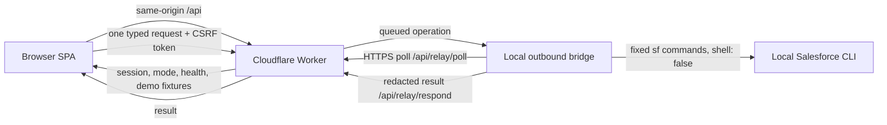

# Data Cloud Architect Toolkit (DCAT)

DCAT is a local-first, read-only workbench for exploring Salesforce Data Cloud / Data 360 metadata. It reads metadata through Salesforce CLI on your own machine and never asks you for a password, token, auth URL, or client secret.

There are two ways to use it:

| Mode | Use it when | Salesforce login happens |
| --- | --- | --- |
| **Local** | You want the full app on your own computer. | In Salesforce CLI on that computer. |
| **Hosted** | You want the public site plus a small local bridge. | In Salesforce CLI on the computer running the bridge. |

Both modes include a clearly labelled **Demo** mode. Demo mode needs no Salesforce CLI, no org, and no network access to Salesforce.

- Repository: https://github.com/herethesavior/data-cloud-architect-toolkit
- Hosted site: https://sfdcat.pages.dev/

> Release status: local discovery, hosted live-org inventory, the outbound bridge, and CI are in place. The current release adds the **Change Impact Analyzer** and the latest stability pass described under [What changed](README.md#what-changed).

## Quick start

### Try the local app in demo mode

Requirements:

- Node.js 22.12 or newer
- npm 10 or newer

```bash
npm install
npm run dev
```

Open **http://127.0.0.1:5173**. The app opens in demo mode, so the sample inventory is visible immediately.

For a production-style local run:

```bash
npm run build
npm start
```

Open **http://127.0.0.1:3847**. The connector serves the built UI and API from the same loopback address.

### Connect a real org locally

Install [Salesforce CLI](https://developer.salesforce.com/docs/platform/salesforce-cli/guide/setup.html) first. It is not an npm dependency of this project.

```bash
sf org login web --alias my-data360-org --set-default

# Sandbox example
sf org login web --alias dcat-uat --set-default \
  --instance-url https://mydomain--uat.sandbox.my.salesforce.com
```

Then use the header control to switch from **Use demo** to **Use live**. The header always states the active context:

- `DEMO DATA`
- `LIVE · SANDBOX`
- `LIVE · PRODUCTION`
- `LIVE · NOT CONNECTED`

The mode choice is saved as `dcat.mode` in local browser storage. The local connector itself starts in live mode unless `DCAT_DEMO=true` is set.

### Use the hosted site with a live org

1. Open **https://sfdcat.pages.dev/**.
2. Open **Org Connections** and start **Step 1: Set up SF CLI**.
3. Create a pairing code and run the command shown on screen:

   ```bash
   npx -y @dcat-toolkit/bridge@latest setup --relay <site-url> --code <code>
   ```

   That one command installs Salesforce CLI if needed, installs the bridge, pairs it with this browser session, and starts it. After a restart, run `npx -y @dcat-toolkit/bridge@latest start`.

4. In **Step 2: Connect org**, choose an alias and, optionally, an HTTPS sandbox URL. Salesforce CLI opens your browser for login. DCAT does not collect credentials.
5. **Step 3: View inventory** starts immediately after the org is connected. A disabled Data 360 feature is shown as **Not enabled**, not as a failed retrieval or an empty dataset.

The pairing code is one-time and short-lived. **Step 1** also contains the bridge update control. The Worker checks npm for the latest bridge release, caches that answer for one hour, and shares one registry request across concurrent status checks. Connected bridges version `0.1.4` or newer can self-update; older bridges receive a fixed, copyable install command. This branch prepares bridge `0.1.5`; the hosted wizard always installs whatever version npm currently marks `@latest`.

## What DCAT does and does not do

| DCAT does | DCAT does not |
| --- | --- |
| Read metadata with allowlisted, read-only Salesforce CLI commands. | Create, update, delete, deploy, activate, ingest, or refresh org data. |
| Show Data Spaces, DLOs, DMOs, mappings, streams, transforms, and relationships. | Query or display customer or transaction records. |
| Show source endpoint, API version, retrieval time, and confidence for metadata. | Invent counts, objects, or relationships. |
| Mark unsupported, forbidden, and partial results explicitly. | Turn a permissions problem into an empty dataset. |
| Keep exports local and user-initiated. | Send org metadata to a third party. |

## Safety boundaries

- Salesforce CLI owns authentication. DCAT never asks for or stores usernames, passwords, tokens, SFDX auth URLs, or client secrets. The browser's inventory cache holds metadata snapshots only.
- The browser never runs `sf`. Hosted mode uses an outbound bridge that polls the Worker; it needs no open inbound port or tunnel.
- The relay accepts only nine typed operations: `cli.status`, `org.list`, `org.connect`, `inventory.get`, `inventory.start`, `inventory.status`, `transform.get`, `mode.set`, and `bridge.update`. There is no arbitrary command or URL proxy, no shell, and no SOQL.
- Process output is redacted before it is returned to the browser. Bridge storage contains only the relay URL, agent token, and version, written with mode `600`; it never reads the CLI credential store.
- The local connector binds only to `127.0.0.1` and validates Host and Origin headers.
- There is no hosted OAuth. `/api/auth/*` paths are intentionally removed and return `404`.
- Demo data is always labelled **Demo**. It never appears under a live label.

See [SECURITY.md](SECURITY.md) for the full security model.

## How hosted mode works



The public site is a static React SPA. A Cloudflare Worker at the same origin owns the browser session, CSRF token, mode, health, demo fixtures, and relay. The browser talks only to that Worker.

## Hosted deployment

`npm run build:pages` builds the hosted SPA and writes `apps/web/dist/_worker.js`. Cloudflare Pages advanced mode serves that Worker automatically. Workers Builds uses the root `wrangler.jsonc` and `npx wrangler deploy`.

| Setting | Value |
| --- | --- |
| Build command | `npm install && npm run build:pages` |
| Build output | `apps/web/dist` |
| Worker deploy command | `npx wrangler deploy` (Workers Builds only) |
| Node version | 22.12.0 or newer |
| KV binding | `DCAT_SESSIONS` exactly |

| KV namespace | ID |
| --- | --- |
| Production | `fd2bbc29b1b2427f87ccf9f8e34e6705` |
| Preview | `0155c4acd0054d5bb60519428b14c5ee` |

After deployment, check that `/api/health` returns JSON and `/api/auth/*` returns `404`.

For a local Pages rehearsal, run `npm run pages:dev` and open **http://127.0.0.1:8788**. For the full dashboard walkthrough, see [docs/CLOUDFLARE_PAGES_SETUP.md](docs/CLOUDFLARE_PAGES_SETUP.md). For the short user guide, see [docs/HOSTED_ONBOARDING.md](docs/HOSTED_ONBOARDING.md).

There are no Worker secrets to set. `apps/hosted-worker/.dev.vars.example` only documents the optional `SESSION_TTL_SECONDS`; never commit a local `.dev.vars`. The standalone Worker commands are still available: `npm run worker:dev`, `npm run worker:dry-run`, and `npm run worker:deploy`.

Worker KV writes are kept small and expire because free-tier KV has write limits. Pairing codes are one-time and short-lived; unpairing invalidates the agent token.

## Using the workbench

- **Navigation:** desktop users can collapse the sidebar to an icon rail; smaller screens use a burger menu. Both controls expose their state to screen readers.
- **Search:** press `Ctrl/Cmd+K` to search the current context's Data Spaces, DLOs, DMOs, streams, mappings, and transforms. Results open the matching explorer or a read-only detail dialog.
- **Themes:** follow the device preference or choose **Light**, **Dark**, or **System** in Settings. The choice is saved as `dcat.theme`.
- **Detail drawers:** open from object rows. They have breadcrumbs, tabs, copy actions, no dimming scrim, a width cap of 640px, and scrolling inside the viewport.
- **Freshness:** a compact chip beside each explorer's filters shows **Updated …** with an exact-time tooltip. Loaded org lists and inventories are restored from this browser after a reload, so navigation does not retrieve them again. A stale dot appears for live snapshots older than 15 minutes; use the token-protected refresh action to retrieve a new snapshot.
- **No org selected:** inventory views show **Select an org** as the primary action and **Use demo mode** as the live-mode fallback.
- **Exports:** available from each explorer's **Export** menu. Live exports first show a short notice that the file contains org metadata. All exports stay local. The ERD Explorer adds a portable Mermaid `.mmd` export; the lineage explorer adds SVG, Mermaid, JSON, and Markdown exports of the visible flow.
- **ERD Explorer:** pan, zoom, drag objects, fit or reset the view, toggle the grid and minimap, and use full screen. Auto-layout can arrange objects left-to-right or top-to-bottom and sort them by connections or alphabetically. Object search and detail panels support focusing one object or relationship. Certainty distinguishes source-confirmed links from inferred or unknown links. Layout and viewport preferences are stored per workspace context in this browser only.
- **Data Lineage Explorer:** trace source systems → streams → DLOs → mappings/transforms → DMOs on one canvas. Filter by step type, link grounding, or Data Space; trace upstream/downstream paths; inspect field mappings, provenance, and integrity gaps; and jump to the owning explorer. Solid links come from snapshot metadata, dashed links are explicitly DCAT-derived, and dotted links name objects missing from the snapshot. Layout, filters, and viewport preferences are stored per workspace context in this browser only.
- **Change Impact Analyzer:** select a DLO, DMO, field, or relationship to review grounded upstream and downstream dependencies before a change. Direct and all-path results are separate, inferred links are labelled, and field-level impact is shown only when the current snapshot names that field. No new metadata is fetched.

## Screens

| Screen | What it shows |
| --- | --- |
| Dashboard | Inventory metrics, discovery stages, health, warnings, quick links, and exports. |
| Org Connections | SF CLI setup, pairing, org login, environment, selection, and remove/restore. |
| Data Spaces | Spaces with linked object and stream counts. |
| DLO / DMO Explorer | Searchable objects, relationship badges, tabbed detail drawers, and exports. |
| Mapping Explorer | Source-to-target mappings with field-level detail. |
| Data Stream Explorer | Ingestion streams with source connectors, target objects, status, cadence, and provenance. |
| Data Transform Explorer | Transform overview, lineage, definition, runs, schedules, and raw metadata. |
| ERD Explorer | Interactive relationship canvas with drag, zoom/pan, full screen, auto-layout, search, details, certainty filtering, and local exports. |
| Data Lineage Explorer | End-to-end grounded flow across sources, streams, DLOs, mappings, transforms, and DMOs with path tracing, gap detection, details, and local exports. |
| Change Impact Analyzer | Grounded upstream and downstream dependency review for a DLO, DMO, field, or relationship, with direct/all-path scopes and evidence labels. |
| Data Dictionary | Unified field reference. |
| Settings & Diagnostics | Connector and CLI status plus privacy summary. |
| Help | Task-first documentation with quick answers, connection and status guidance, a question-to-explorer map, link-grounding rules, a filterable glossary, privacy limits, and contact links. Topics are URL-addressable so reload, back/forward, and shared links keep your place. |
| About DCAT | Product story, boundaries, roadmap context, and a full-screen deck view. |

The demo inventory is fully labelled and intentionally healthy. It contains eight DLOs, eight DMOs, seven field-level mappings, six streams, five transforms, and nine labelled ERD relationships so the explorers can be evaluated without implying that live data was discovered. The lineage explorer joins those families into 30 steps and 43 links, including source connector nodes, transform inputs/outputs, and explicit derived links; no references are missing in demo mode.

## How live discovery works

1. DCAT reads the latest supported Salesforce API version. If that fails, it requests no metadata.
2. It probes Data Spaces, DLOs, DMOs, streams, and transforms independently. Mappings are queried per DMO developer name, limited to DMOs the source marks enabled, custom, or externally mapped.
3. A `403` is shown as **forbidden** and an endpoint-level `404` or unsupported endpoint as **unsupported**. A mapping-specific `NOT_FOUND` means that DMO has no mappings and is recorded as no result; malformed responses remain **errors**.
4. Successful families still populate the inventory when other families fail. Discovery Health and **Needs attention** explain the gaps and stay inside the viewport.
5. Transient failures get one retry. Forbidden and unsupported families are never retried.
6. Pagination follows Salesforce `nextPageUrl` values. DMO responses have no continuation cursor, so DCAT reads 100-row offset pages until a short page. With a known Data Space, mapping lookups also send the `dataspace` filter. If the page limit is reached, results are marked **partial**.
7. Loaded org lists and inventory snapshots are saved in this browser's IndexedDB cache (metadata only) for up to 7 days and restored after a reload. Navigation reads that snapshot; only the UI refresh action retrieves a new one with a token-protected request.
8. Transform detail is lazy and read-only: opening a transform calls only three allowlisted GET candidates. Each section reports its own status instead of appearing empty.

Workspace contexts (`demo:${alias}` or `live:${alias}:${orgId}`) namespace inventory, transform, and ERD caches. The org list is also scoped by mode before it is persisted. Switching mode or org cancels in-flight requests and clears the old context before the new one renders, so demo metadata cannot appear under a live label and one org's data cannot appear under another.

## Configuration

Copy `.env.example` to `.env` only if you need to change a local setting. It holds no secrets.

| Variable | Default | Purpose |
| --- | --- | --- |
| `DCAT_PORT` | `3847` | Connector port, always bound to `127.0.0.1`. |
| `DCAT_DEMO` | `false` | Start in demo mode. |
| `DCAT_DATA_DIR` | `.dcat-data` | Reserved for local snapshot and export files. |
| `SESSION_TTL_SECONDS` | `2592000` | Optional Worker session lifetime; set in `.dev.vars` for local Worker development. |

## Scripts

| Command | Description |
| --- | --- |
| `npm run dev` | Run the connector and Vite UI together. |
| `npm run dev:connector` | Run only the local connector on port 3847. |
| `npm run dev:web` | Run only the Vite UI on port 5173. |
| `npm run build` | Type-check, build the local UI, and emit the Pages Worker via `postbuild`. |
| `npm run build:hosted` | Type-check and build hosted assets only. |
| `npm run build:pages` | Build hosted assets and the Pages Worker bundle. |
| `npm run pages:dev` | Build and serve the Pages output locally with a KV binding. |
| `npm run build:bridge` | Bundle `@dcat-toolkit/bridge`. |
| `npm run pack:bridge` | Build and pack the bridge npm tarball. |
| `npm start` | Serve the built UI and API from the connector. |
| `npm run worker:dev` | Build the hosted UI and run the Worker locally. |
| `npm run worker:dry-run` | Build the hosted UI and verify the Wrangler bundle. |
| `npm run worker:deploy` | Build the hosted UI and deploy the Worker. |
| `npm run typecheck` | Strict TypeScript check across apps and packages. |
| `npm test` | Run Vitest unit and integration tests. |
| `npm run test:watch` | Watch mode for tests. |
| `npm run test:e2e` | Run both Playwright suites. First run: `npx playwright install chromium`. |
| `npm run test:e2e:local` | Run only the local mocked-connector suite. |
| `npm run test:e2e:hosted` | Run only the hosted pairing, connect, and inventory suite. |

The bridge source is in `packages/bridge` and is published to npm as `@dcat-toolkit/bridge`. The hosted wizard always installs `@latest`.

## Salesforce CLI notes

These behaviours were verified against `@salesforce/cli/2.158.7`:

- `sf org list --json` returns orgs under `other`, `nonScratchOrgs`, `sandboxes`, `devHubs`, and `scratchOrgs`. It can include an access token; the adapter strips it immediately.
- `sf api request rest` uses a positional endpoint URL with `--method GET --target-org <alias>`.
- On Windows, DCAT resolves the `sf.cmd` shim to its Node entry point so child processes still use `shell: false` and argument arrays. The resolver uses the platform path separator, so the same tests pass on Linux and macOS.
- `sf org list` can be slow while the CLI refreshes status. It is bounded at 90 seconds and cached for 60 seconds.
- Update and beta notices are suppressed. Real Salesforce REST errors on stdout are preserved and shown first. `FUNCTIONALITY_NOT_ENABLED` is reported as **Not enabled**, not as a CLI or update failure.

The Data 360 endpoint allowlist lives in `packages/data360-api`.

## Validation and CI

GitHub Actions runs on pull requests and pushes to `main`:

- typecheck
- unit and integration tests
- local and hosted Playwright suites, serialized in CI
- Pages and bridge builds
- Worker dry run

Actions are SHA-pinned, `GITHUB_TOKEN` is read-only, and Dependabot checks Actions and npm weekly.

Release verification commands:

```bash
npm run typecheck
npm test                       # 197 passed
npm run test:e2e:local         # 27 passed
npm run test:e2e:hosted        # 4 passed
npm run build:pages
npm run build:bridge
npm run worker:dry-run         # confirms the DCAT_SESSIONS binding
```

Live-site checks covered `/api/health`, `/api/relay/status`, built assets, and the intentional `404` responses from `/api/auth/*`. A live CLI probe returned the exact `FUNCTIONALITY_NOT_ENABLED: This feature is not currently enabled for this user type or org: [CdpDataSpace]` message, confirming honest capability reporting. The published `0.1.4` tarball was inspected previously; this branch prepares `0.1.5`, and its local bundle was verified.

## What changed

- The new **Change Impact Analyzer** traces grounded upstream and downstream dependencies from a selected DLO, DMO, field, or relationship. It separates direct from all-path impact, labels inferred and missing paths, and shows field-level impact only when the current snapshot names that field.
- Stream details and exports now show resolved source-connector and configured-connection labels from Data 360 lookups while keeping the raw connector code stable for lineage, joins, and exports.
- A stability pass fixed progressive ERD refresh, normalized case-insensitive joins across explorers, and polished the dashboard hero without changing tested copy or CTA labels.
- The **Data Stream Explorer** lists streams with their source connector, target DLO, status, cadence, and provenance. Command-search stream results open it directly, and its detail drawer keeps the shared breadcrumb, tab, copy, and no-scrim behavior.
- Shared drawers and menus now restore focus only after close animations finish, allow Tab to leave an open export menu, and show a visible message when clipboard access is blocked.
- Connected orgs are classified as sandbox or production from CLI metadata (`isSandbox`, `isScratch`, `isDevHub`) plus safe URL inference. A hyphenated Developer Edition host is no longer mislabeled as a sandbox, and older bridges returning `unknown` are normalized in the web client.
- Switching between demo and live cancels in-flight org fetches, clears the shared org cache, and filters `demo-fixture` orgs out of live views.
- **View inventory** has a per-row **Remove** action with confirmation. It hides the org from DCAT only; Salesforce CLI authentication is untouched. **Show removed orgs** restores it, and reconnecting the alias restores it automatically.
- The Worker shares one in-flight npm registry check across concurrent status requests.
- The Windows `.cmd` shim resolver now uses the platform path separator, so the unit suite passes on Linux as well as Windows.
- The npm lockfile is compatible with npm 10.9.9, which Cloudflare Pages uses during deployment.
- CI is least-privilege, SHA-pinned, and serial for E2E.

## Repository layout

```text
apps/
  web/                 React + Vite + Tailwind workbench
  local-connector/     Fastify local API and CLI boundary
  hosted-worker/       Worker for sessions, health, demo fixtures, and relay
packages/
  bridge/              Local installer and outbound agent CLI
  core/                Domain types, provenance, and operation allowlist
  salesforce-cli/      Safe process wrapper, parsers, and redaction
  data360-api/         Version discovery, endpoint registry, and inventory
  exporters/           Local export helpers
  test-fixtures/       Sanitized CLI output and demo inventory
docs/
  HOSTED_ONBOARDING.md
  CLOUDFLARE_PAGES_SETUP.md
```
