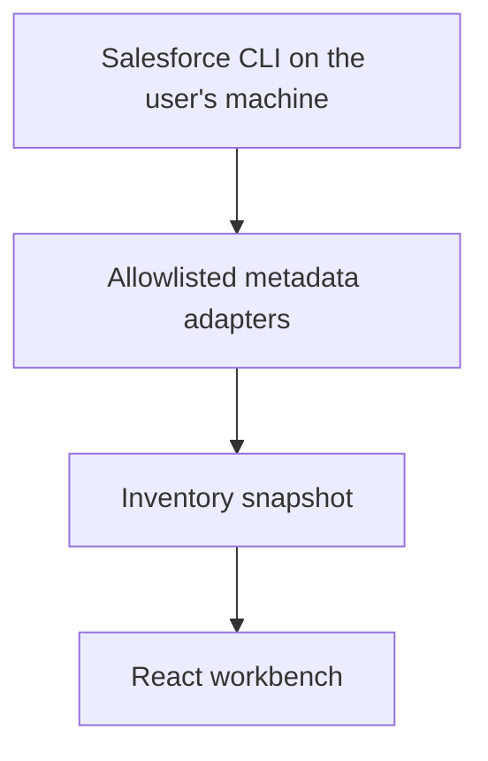
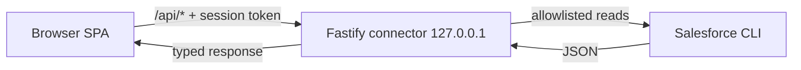
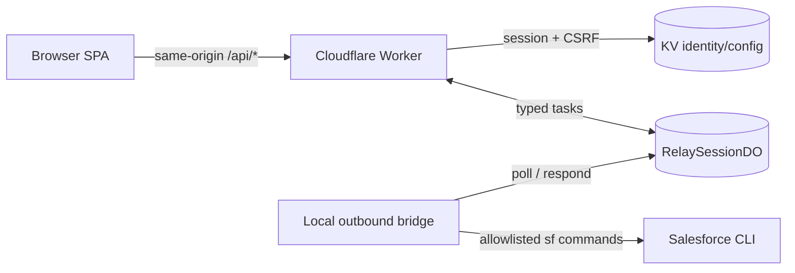

# DCAT architecture

DCAT is a read-only workbench for Salesforce Data Cloud / Data 360 metadata. It runs Salesforce CLI commands on the user's own machine, turns their JSON output into one consistent inventory snapshot, and renders explorers, lineage, and impact views from that snapshot. It never asks for a password, token, auth URL, or client secret, and it never displays customer records.

This document explains how the pieces fit together. For setup instructions, start with the [README](../README.md); for hosted deployment details, see [Cloudflare Pages setup](CLOUDFLARE_PAGES_SETUP.md) and [Hosted onboarding](HOSTED_ONBOARDING.md).

## The short version

There are two ways to reach the same inventory:

- **Local mode:** the browser talks to a Fastify connector on `127.0.0.1`; that connector runs Salesforce CLI directly.
- **Hosted mode:** the browser talks to a Cloudflare Worker; a small outbound bridge on the user's machine polls that Worker and runs Salesforce CLI locally.

Demo mode replaces the CLI with labelled fixtures from `packages/test-fixtures`. It never passes as live data.

## Repository map

| Path | Role |
| --- | --- |
| `apps/web` | React + Vite + Tailwind workbench, routing, views, browser cache, and UI state. |
| `apps/local-connector` | Fastify API bound to loopback; session, org, compatibility, health, and transform routes. |
| `apps/hosted-worker` | Cloudflare Worker: sessions, health, demo fixtures, relay endpoints, and the Durable Object. |
| `packages/bridge` | Published npm CLI that pairs with the hosted site and executes typed relay operations locally. |
| `packages/salesforce-cli` | `sf` process wrapper, Windows shim resolution, JSON parsing, error mapping, and output redaction. |
| `packages/data360-api` | API version rules, endpoint registry, metadata discovery, pagination, connector lookups, and transform detail. |
| `packages/core` | Shared Zod schemas, domain types, compatibility types, relay contract, and inventory chunking helpers. |
| `packages/exporters` | CSV, JSON, Markdown, ERD, lineage, and impact analysis helpers. |
| `packages/test-fixtures` | Sanitized CLI responses and the labelled demo inventory. |
| `e2e` | Playwright suites for the local connector and hosted relay. |
| `scripts` | Build helpers, including the Pages `_worker.js` bundle. |

Packages depend toward `packages/core`. The web app never imports Salesforce CLI code directly, and the CLI packages never import React; that boundary is what makes both local and hosted modes possible.

## Core concepts

### Workspace context

A workspace context identifies exactly which inventory is on screen:

- Demo: `demo:${alias}`
- Live: `live:${alias}:${orgId}`

It is defined in `apps/web/src/lib/workspace.ts` and used as the React Query key namespace in `apps/web/src/lib/useInventory.ts`. Switching mode or org cancels in-flight work and clears the old context before the new one renders, so demo data cannot appear under a live label and one org cannot leak into another.

### Inventory snapshot

`InventorySnapshot` in `packages/core/src/domain.ts` is the single client-side contract. It contains:

- `org` and API version metadata.
- Six discovered families: `dataSpaces`, `dlos`, `dmos`, `mappings`, `dataStreams`, and `dataTransforms`.
- Derived `relationships`.
- `capabilities`, one retrieval result per family.
- `warnings` for partial, unsupported, forbidden, omitted, and chunked results.
- `progress`, a discovery envelope with per-family counts and a running/partial/complete/failed state.
- `provenance` on records: source endpoint, retrieval time, API version, and confidence.

Every explorer, the data dictionary, ERD, lineage graph, impact analyzer, and export reads this snapshot. DCAT does not invent missing objects, fields, or links; unresolved references are kept as explicit gaps.

### Retrieval status

A family can be `not-started`, `available`, `unsupported`, `forbidden`, `error`, or `partial`. A `403` is forbidden, an endpoint-level `404` is unsupported, and a mapping-specific `NOT_FOUND` means "no mappings for this DMO", not a failed request. Successful families still render when other families fail; the UI explains the gap rather than showing an empty dataset.

### Error recovery

`apps/web/src/lib/userError.ts` translates API codes into calm, actionable copy and one of three recovery actions:

- `connect`: open Org Connections and repair pairing or CLI setup.
- `retry`: retry a genuinely transient failure.
- `continue`: request the next batch for an oversized inventory.

Setup/configuration errors do not get a meaningless retry button; timeouts, stale sessions, busy relays, and transport failures do.

## Local mode

1. `npm run dev` starts Vite on port 5173 and the connector on port 3847. `npm start` serves built assets from the connector instead.
2. `apps/local-connector/src/app.ts` registers routes for health, session, compatibility, orgs, and transforms. `apps/local-connector/src/security.ts` binds to loopback and validates Host and Origin.
3. `apps/local-connector/src/state.ts` holds connector state and discovery sessions (`discovery-sessions.ts`). Salesforce CLI calls are serialized because the CLI shares auth/config state.
4. `packages/salesforce-cli/src/run.ts` spawns fixed commands with an argument array and `shell: false`. It resolves the Windows `sf.cmd` shim to its Node entry point so the same code works cross-platform. `redact.ts` strips tokens and noisy update output before results leave the connector.
5. `packages/data360-api/src/discover.ts` and `progressive.ts` probe families independently. `pagination.ts` follows Salesforce `nextPageUrl` values and reads 100-row offset pages where no continuation cursor exists. `connectors.ts` resolves connector and connection labels; `transforms.ts` fetches lazy transform detail through three allowlisted GET candidates.
6. The browser receives snapshots through `apps/web/src/lib/api.ts`. `useInventory.ts` merges partial results into an IndexedDB-backed React Query cache so rows appear as batches arrive.

## Hosted mode

### Browser and Worker

The static SPA and `/api/*` routes share one origin. `apps/hosted-worker/src/pages.ts` owns routing, security headers, session cookies, CSRF checks, and demo fixtures. `apps/hosted-worker/src/session.ts` and `packages/core/src/relay.ts` define the browser-facing contract.

KV is only the identity/config plane: `session:<id>` and one-time `pairing:<code>` keys. Keeping always-on polling out of KV matters because the free plan has a low daily read limit.

### Relay and bridge

Hot relay state lives in one SQLite-backed `RelaySessionDO` per paired bridge (`apps/hosted-worker/src/relay-do.ts`, exported by `relay-session-do.ts`). It stores heartbeats, the queued operation, the claimed task, and the latest result. A queued operation wakes an idle poll immediately.

The browser can only send typed operations: `cli.status`, `org.list`, `org.connect`, `inventory.get`, `inventory.start`, `inventory.status`, `transform.get`, `mode.set`, `compatibility.set`, and `bridge.update`. There is no arbitrary command, URL proxy, shell, or SOQL. `packages/bridge/src/main.ts` long-polls `/api/relay/poll` with an agent token, runs the allowlisted local command, redacts output, and posts the result to `/api/relay/respond`. It needs no inbound port or tunnel.

Pairing is one-time and short-lived. Unpairing invalidates the agent token in both KV and the Durable Object. Bridge storage (`~/.dcat/bridge.json`, mode `600`) contains only the relay origin, agent token, and version—never Salesforce credentials.

The agent is designed to stay up for days. Relay calls have deadlines (45 seconds for an idle long poll), installer and updater processes are bounded, and logs are leveled: normal output records each request with its duration while progress polls stay in `--verbose`. Repeated relay failures are summarized every five minutes instead of printed on every retry, and recovery is announced once. Output is timestamped and redacted.

The Worker checks npm for the latest bridge release and caches that answer for one hour. Step 1 of the hosted wizard shows a copyable upgrade command when the paired bridge is behind; the wizard itself always installs `@dcat-toolkit/bridge@latest`.

## Inventory lifecycle

1. **Choose an API version.** DCAT offers the recommended version, the latest available version, or a curated specific version. The version setting belongs to the bridge/local connector, not the browser; demo mode stays on its fixed fixture version.
2. **Discover families independently.** Data Spaces, DLOs, DMOs, streams, and transforms are probed in parallel at the adapter level; mapping lookups are limited to DMOs the source marks enabled, custom, or externally mapped.
3. **Stream partial results.** `onSnapshot` callbacks publish each batch to the browser. `apps/web/src/lib/inventoryMerge.ts` unions rows by identity so a later chunk cannot replace already-loaded rows.
4. **Label gaps.** Capabilities, warnings, and progress appear in `InventoryBoundary`, Discovery Health, and Needs attention. Partial data stays visible and is explicitly marked incomplete.
5. **Retry or resume deliberately.** Transient failures get one retry; forbidden and unsupported families are never retried. A stopped inventory exposes **Resume loading**, while a terminal oversized result exposes **Continue loading**.
6. **Cache locally.** Loaded org lists and inventories are persisted in IndexedDB for up to seven days. A reload reads the snapshot; only the explicit refresh action starts a new retrieval with a token-protected request.

## Oversized metadata and pagination

Large orgs can exceed the relay's 5 MiB response cap. The fix is split between the relay and the browser; the published bridge does not need to change.

1. `chunkInventorySnapshot` in `packages/core/src/inventoryChunks.ts` splits an inventory snapshot into ordered, relay-sized chunks. Oversized single rows are compacted and reported with an omission warning.
2. Every chunk carries `RESPONSE_CHUNKED`; all but the last also carry `MORE_ITEMS_AVAILABLE`. The Durable Object stores chunks and advances the cursor only when the browser polls for that same request.
3. The browser receives each chunk as a normal snapshot through `onSnapshot`, merges it by identity, and keeps loaded rows on screen. The final chunk arrives through the normal completed-snapshot path.
4. Non-inventory results still surface `RESPONSE_TOO_LARGE`. **Continue loading** starts a fresh forced inventory session rather than replaying a terminal request.
5. Client-side pagination is shared by `DataTable` and `PaginatedList` (`apps/web/src/components/ui`). Tables, cards, detail lists, impact results, lineage lists, ERD lists, transform object references, and search-like inventories are paged. The page is clamped while rendering so filters that shrink a result set never flash an empty page.
6. Graph canvases are intentionally not paginated: ERD and lineage views need the full relationship graph for layout, minimap, tracing, and exports. Their detail panels and list panels are paginated.

## Views and derived data

- **Dashboard** summarizes capabilities and discovery health; it does not compute a fake progress percentage.
- **Data Spaces, DLO/DMO, Mapping, Stream, Transform, and Dictionary explorers** are filtered views of the snapshot with detail drawers and local exports.
- **Object Explorer** joins fields, relationships, mappings, and streams for one object without inferring links from names.
- **ERD Explorer** builds nodes and edges from snapshot relationships. Certainty distinguishes confirmed, inferred, and unknown links.
- **Data Lineage Explorer** builds a grounded flow from sources through streams, DLOs, mappings/transforms, and DMOs. Solid, dashed, and dotted links mean source-named, derived, and missing-reference respectively.
- **Change Impact Analyzer** computes upstream/downstream dependency groups in the browser. It separates direct from all-path results and never claims field-level continuity that the snapshot does not contain.
- **Exporters** turn the same snapshot or derived graph into CSV, JSON, Markdown, Mermaid, or SVG. Exports are user-initiated and stay local.

## Security and privacy boundaries

- Salesforce CLI owns authentication. DCAT never receives or stores usernames, passwords, security tokens, SFDX auth URLs, or client secrets.
- The browser never runs `sf`. Local mode crosses a loopback API; hosted mode crosses an outbound relay with a fixed typed operation allowlist.
- Process output is redacted before it is shown or relayed. Malformed responses become explicit errors, not invented results.
- Hosted OAuth is deliberately absent: `/api/auth/*` returns `404`. There are no OAuth secrets, callback URLs, or token encryption keys to configure.
- API responses set `no-store`, `nosniff`, `no-referrer`, and frame-denial headers.
- Demo data is always labelled Demo and is namespaced away from live workspaces.
- See [SECURITY.md](../SECURITY.md) for the complete security model.

## Build, test, and deploy

| Command | Purpose |
| --- | --- |
| `npm run typecheck` | Strict TypeScript check across all apps and packages. |
| `npm test` | Vitest unit and integration tests. |
| `npm run test:e2e:local` | Playwright suite against the mocked local connector. |
| `npm run test:e2e:hosted` | Playwright suite for pairing, connect, and hosted inventory. |
| `npm run build` | Local UI build plus Pages worker output. |
| `npm run build:pages` | Hosted UI assets, `_worker.js`, and asset ignore file. |
| `npm run build:bridge` | Bundle the publishable bridge CLI. |
| `npm run worker:dry-run` | Verify the Wrangler bundle and bindings. |
| `npm run pages:dev` | Local hosted rehearsal with KV and Durable Object bindings. |

CI runs typecheck, unit tests, both Playwright suites, builds, and a Worker dry run on pull requests and pushes to `main`. Actions are SHA-pinned and `GITHUB_TOKEN` is read-only.

Hosted production uses Cloudflare account `eb30896906e2d4ac8fa6e06054bad6ad`, Pages project `sfdcat`, and the production site `https://sfdcat.pages.dev/`. Workers Builds deploys the root `wrangler.jsonc`; Pages advanced mode deploys `apps/web/dist/_worker.js`. Both require bindings named exactly `DCAT_SESSIONS` and `RELAY_DO`. The Durable Object class is `RelaySessionDO` with SQLite storage. Do not enable Cloudflare Access on the production hostname: the bridge CLI needs `/api/relay/*` to remain reachable.

## Where to start reading

| Question | File |
| --- | --- |
| What shape is the inventory? | `packages/core/src/domain.ts` |
| What can cross the relay boundary? | `packages/core/src/relay.ts` |
| How does discovery work? | `packages/data360-api/src/discover.ts`, `progressive.ts`, `pagination.ts` |
| How does the browser load and cache it? | `apps/web/src/lib/api.ts`, `useInventory.ts`, `inventoryMerge.ts` |
| How does the local API work? | `apps/local-connector/src/app.ts`, `state.ts` |
| How does the hosted relay work? | `apps/hosted-worker/src/pages.ts`, `relay-do.ts`, `session.ts` |
| How does the bridge work? | `packages/bridge/src/main.ts`, `config.ts` |
| How is the UI assembled? | `apps/web/src/App.tsx`, `components/InventoryBoundary.tsx`, `components/ui` |
| How are extras computed? | `packages/exporters/src/impact.ts`, `lineage.ts`, `erd.ts` |
